# DocuMind AI — Intelligent Document Assistant using Local RAG

[](https://www.python.org/downloads/)
[](https://python.langchain.com/)
[](https://www.trychroma.com/)
[](https://ollama.com/)
[](https://streamlit.io/)
[](LICENSE)

An enterprise-ready, fully local **Retrieval-Augmented Generation (RAG)** system that allows users to upload PDF documents, engage in multi-turn natural language conversations, retrieve semantically relevant passages, and generate accurate, grounded answers backed by verified source citations—all running locally with zero cloud API dependencies.

---

## 1. Business Problem

Organizations routinely struggle with knowledge retrieval across disparate, lengthy PDF documents such as employee handbooks, security policies, compliance standards, and technical specifications:
- **Search Inefficiencies**: Keyword searches fail to capture semantic intent and conceptual nuances.
- **Data Privacy & Compliance**: Uploading proprietary company data to third-party proprietary APIs (like OpenAI or Anthropic) introduces compliance risks, vendor lock-in, and unpredictable subscription costs.
- **LLM Hallucinations**: Standard language models invent facts without direct evidence and lack traceable citations.
- **Prompt Injection Vulnerabilities**: Uploaded documents may contain untrusted text designed to override system prompt instructions.

**DocuMind AI** solves these challenges by providing a 100% private, locally deployed, evidence-grounded AI assistant with file-level deduplication, deterministic chunk tracking, prompt injection defenses, and verified source citations.

---

## 2. Key Features

- **Document Processing Pipeline**:
  - Validates and parses text-based PDFs via `PyPDFLoader`.
  - Normalizes page indices to human-friendly 1-based page numbering.
  - Automatically identifies scanned or image-only PDFs and warns users that OCR is required.
  - Recursively splits documents with `chunk_size=1000` and `chunk_overlap=200` while retaining document provenance.
- **Vector Storage & Deduplication**:
  - Generates 768-dimensional embeddings via local `nomic-embed-text`.
  - Computes deterministic SHA-256 file hashes to detect duplicate uploads and eliminate redundant re-embeddings.
  - Persists collections in ChromaDB with document-level atomic deletion capabilities.
- **Evidence-Grounded RAG & Security**:
  - Runs local inference using Meta's `llama3.2` via `ChatOllama` at `temperature=0.0`.
  - Wraps retrieved text in explicit untrusted boundaries, preventing user documents from hijacking system instructions.
  - Explicitly states when requested information is missing rather than fabricating facts.
- **Multi-Turn Conversational Memory**:
  - Maintains session-isolated conversation history to prevent cross-user data leakage.
  - Contextualizes follow-up questions into standalone semantic retrieval queries.
- **Verified Source Citations**:
  - Displays supporting document names, page numbers, and preview text snippets in collapsible citation cards.
- **Modern User Experience**:
  - Custom dark theme built with Streamlit featuring blue and purple accents, health status monitors, real-time metrics, and conversational reset controls.

---

## 3. Technology Stack

| Layer | Technology | Purpose |
| :--- | :--- | :--- |
| **Generative LLM** | Ollama (`llama3.2:latest`) | Local, deterministic text generation (Temperature 0.0) |
| **Embeddings** | Ollama (`nomic-embed-text`) | 768-dimensional semantic embeddings |
| **Orchestration** | LangChain Core & Community | Chains, prompt templates, and document pipelines |
| **Vector Database** | ChromaDB (`langchain-chroma`) | Persistent vector storage and similarity search |
| **PDF Extraction** | PyPDF / PyMuPDF | Text parsing and page metadata preservation |
| **Frontend** | Streamlit | Responsive dark-theme conversational UI |
| **Configuration** | Pydantic & python-dotenv | Strongly-typed environment settings |
| **Testing** | Pytest | Automated unit, integration, and UI tests |

---

## 4. System Architecture

```mermaid
flowchart TD
    subgraph Ingestion["1. Document Ingestion Pipeline"]
        A["PDF Uploads"] --> B["SHA-256 Hashing & Deduplication"]
        B --> C["PyPDFLoader & Text Extraction"]
        C --> D["Recursive Character Splitter<br/>(1000 chars / 200 overlap)"]
        D --> E["OllamaEmbeddings<br/>(nomic-embed-text)"]
        E --> F[("ChromaDB Vector Store")]
    end

    subgraph Conversation["2. Conversational RAG Query Flow"]
        G["User Question"] --> H{"Chat History Exists?"}
        H -- "Yes" --> I["Query Contextualizer<br/>(Standalone Query Formulation)"]
        H -- "No" --> J["Raw User Question"]
        I --> K["ChromaDB Similarity Search<br/>(Top-K Chunks)"]
        J --> K
        K --> L["Format Context with Security Delimiters"]
        L --> M["ChatOllama (llama3.2, temp=0.0)<br/>System Guardrails & Citation Prompt"]
        M --> N["Grounded Answer + Source Citations"]
        N --> O["Update Session History"]
    end
```



---

## 5. Installation & Setup

### Prerequisites
- Python 3.11 or higher
- Git
- [Ollama](https://ollama.com/) installed and running locally

### Step 1: Clone Repository
```bash
git clone https://github.com/your-username/documind-ai.git
cd documind-ai
```

### Step 2: Configure Environment
Create and activate a virtual environment:
```bash
python -m venv venv

# Windows (PowerShell)
.\venv\Scripts\Activate.ps1

# Linux / macOS
source venv/bin/activate
```

Copy the example environment configuration:
```bash
cp .env.example .env
```

### Step 3: Install Dependencies
```bash
pip install -r requirements.txt
```

### Step 4: Download Local Models
Ensure Ollama is running (`ollama serve`), then pull the required models:
```bash
ollama pull llama3.2
ollama pull nomic-embed-text
```

---

## 6. Running the Application

Launch the Streamlit web application:
```bash
streamlit run app.py
```

The application will automatically open in your default browser at `http://localhost:8501`.

---

## 7. Example Questions

Once you have uploaded a PDF (e.g., an employee handbook or policy document), try asking:

1. **Policy Inquiries**:
   > *"What is the standard procedure and lead time required for booking planned leave?"*
2. **Follow-Up Conversational Questions**:
   > *"How many days does that cover?"*
3. **Specific Factual Queries**:
   > *"What are the exact coverage limits and deductibles for health insurance?"*
4. **Out-of-Domain / Grounding Test**:
   > *"What is the company policy regarding bringing dogs into the office?"*
   *(Expected response: States clearly that this information is not found in the documents, rather than hallucinating).*

---

## 8. Application UI Screenshots

> *Placeholder: Screenshots of the modern dark-themed interface, upload drawer, and source citation cards.*

| Interface | View |
| :--- | :--- |
| **Main Chat & Citation Accordion** |  |
| **Document Management & Sidebar** |  |

---

## 9. Automated Testing & Benchmark Evaluation

### Running Automated Unit & Integration Tests
Run the complete Pytest suite (covers document loader, chunking, deduplication, vector store, retriever, conversational history, and Streamlit AppTest):
```bash
pytest -v
```

### Running the Empirical RAG Evaluation Benchmark
Run the evaluation benchmark to measure real-world performance against the local models:
```bash
python -m src.evaluate
```

### Empirical Benchmark Results

Measured locally on Windows 11 with Ollama (`llama3.2` + `nomic-embed-text`):

| Evaluation Metric | Measured Result | Benchmark Method |
| :--- | :--- | :--- |
| **Retrieval Recall@K** | **100.0%** | Fraction of queries where the ground-truth document chunk was retrieved in top-3 candidates |
| **Citation Accuracy** | **100.0%** | Percentage of answers with correct source document name and 1-based page number (and 0 hallucinated citations on unanswerable queries) |
| **Answer Faithfulness** | **100.0%** | Strict verification that answer claims are supported by retrieved evidence and out-of-domain queries are properly refused |
| **Average Response Latency** | **16.98s** | Mean end-to-end latency across contextualization, vector retrieval, and LLM answer generation |
| **Latency Range** | **12.34s – 19.46s** | Min and max response time depending on context length and reasoning complexity |

#### Benchmark Query Breakdown
```json
[
  {
    "question": "How many days in advance should employees submit planned leave requests?",
    "is_answerable": true,
    "expected_fact": "5 working days",
    "retrieval_hit": true,
    "citation_correct": true,
    "faithful": true,
    "latency_sec": 12.34
  },
  {
    "question": "What is the annual coverage limit for preventive dental and vision care?",
    "is_answerable": true,
    "expected_fact": "$2,000",
    "retrieval_hit": true,
    "citation_correct": true,
    "faithful": true,
    "latency_sec": 19.36
  },
  {
    "question": "What is the minimum password length and how often must it be rotated?",
    "is_answerable": true,
    "expected_fact": "14 characters",
    "retrieval_hit": true,
    "citation_correct": true,
    "faithful": true,
    "latency_sec": 17.95
  },
  {
    "question": "What are the multi-factor authentication requirements for remote VPN access?",
    "is_answerable": true,
    "expected_fact": "hardware security key",
    "retrieval_hit": true,
    "citation_correct": true,
    "faithful": true,
    "latency_sec": 19.46
  },
  {
    "question": "What is the reimbursement allowance for home gym equipment?",
    "is_answerable": false,
    "expected_fact": "cannot find sufficient information",
    "retrieval_hit": true,
    "citation_correct": true,
    "faithful": true,
    "latency_sec": 15.78
  }
]
```

---

## 10. Known Limitations

- **Scanned / Image-Only PDFs**: Text-based PDFs are fully supported. Scanned image documents require OCR (e.g., Tesseract), which is outside the current scope.
- **Multi-Modal Tables / Complex Charts**: Visual flowcharts and heavily styled multi-column tables may lose structural hierarchy during raw text extraction.
- **Local Compute Bound**: Performance depends on host hardware (GPU/CPU) running Ollama.

---

## 11. Future Roadmap

- [ ] **OCR Engine Integration**: Add optional OCR fallback (Tesseract or Surya) for scanned PDFs.
- [ ] **Hybrid Search**: Combine dense vector retrieval with BM25 sparse keyword ranking.
- [ ] **Reranking Layer**: Integrate Cross-Encoder rerankers (e.g., `bge-reranker-large`) to optimize retrieved chunk ordering.
- [ ] **Multi-Tenant User Authentication**: Implement user-level authentication and role-based document access control (RBAC).

---

## 12. License

This project is licensed under the MIT License — see the [LICENSE](LICENSE) file for details.
